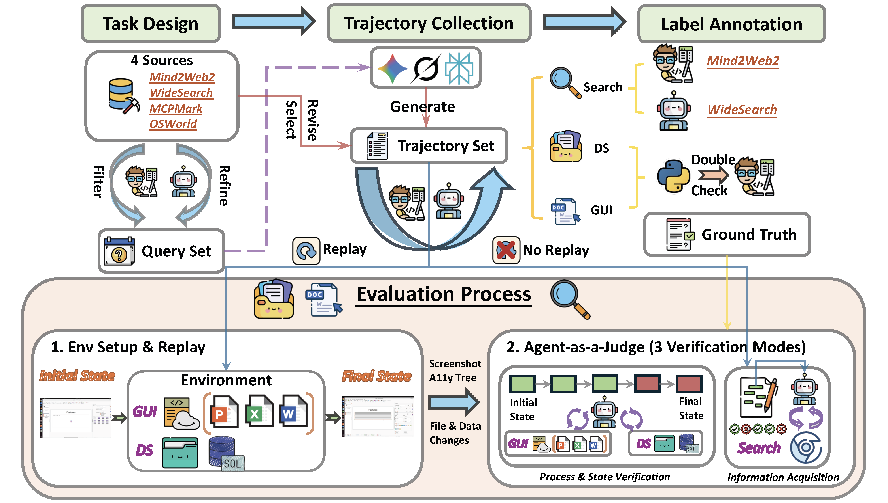

<div align="center">

# AJ-Bench: Benchmarking Agent-as-a-Judge for Environment-Aware Evaluation

[](https://aj-bench.github.io) []()
</div>

## 📖 Introduction

In this paper, we introduce **AJ-Bench**, a comprehensive benchmark designed to evaluate **Agent-as-a-Judge** systems in environment-aware settings. Comprising **155 tasks** and **516 annotated trajectories** across **Search**, **DS**, and **GUI** domains, AJ-Bench assesses judge agents’ abilities in information acquisition, state verification, and process verification. We propose a rigorous evaluation framework using the F1 score to measure the alignment between agent predictions and ground-truth annotations. Our experiments demonstrate that Agent-as-a-Judge achieves consistent performance gains over LLM-as-a-Judge baselines, with an overall F1 score improvement of up to **13.41%**.

AJ-Bench is constructed through domain-specific pipelines to reflect the distinct nature of verification across different environments.

- **Search Domain**: Deep and wide information-seeking tasks requiring external evidence verification. Labels are assigned at the item level and validated against authoritative sources.
- **DS Domain**: Executable environments where correctness is defined by concrete file/database state changes.
- **GUI Domain**: Real desktop tasks with replayable environments, enabling multimodal state and process verification.

<p align="center">
  
</p>

## 🌱 Benchmark Statistics

AJ-Bench provides a multi-domain evaluation environment to test agents' capabilities in judging complex tasks.

<table align="center">
  <thead>
    <tr>
      <th rowspan="2">Statistic</th>
      <th colspan="2">Search</th>
      <th colspan="2">DS</th>
      <th colspan="3">GUI</th>
      <th rowspan="2">Overall</th>
    </tr>
    <tr>
      <th>Wide</th>
      <th>Deep</th>
      <th>FileSystem</th>
      <th>Postgres</th>
      <th>PPT</th>
      <th>Word</th>
      <th>Excel</th>
    </tr>
  </thead>
  <tbody align="center">
    <tr>
      <td align="left"><strong>Task Count</strong></td>
      <td>9</td>
      <td>52</td>
      <td>24</td>
      <td>18</td>
      <td>21</td>
      <td>12</td>
      <td>19</td>
      <td><strong>155</strong></td>
    </tr>
    <tr>
      <td align="left"><strong>Trajectory Count</strong></td>
      <td>27</td>
      <td>156</td>
      <td>129</td>
      <td>100</td>
      <td>42</td>
      <td>24</td>
      <td>38</td>
      <td><strong>516</strong></td>
    </tr>
    <tr>
      <td align="left"><strong>Tool Count</strong></td>
      <td>22*</td>
      <td>22*</td>
      <td>14</td>
      <td>9</td>
      <td>15†</td>
      <td>15†</td>
      <td>15†</td>
      <td><strong>60</strong></td>
    </tr>
  </tbody>
</table>

> \* Search tasks share the same tool set.  
> † GUI tasks share the same tool set.

## 🛠️ Quick Start

### 1. Installation

Clone the repository and install the base dependencies:

```bash
# Clone the AJ-Bench repository
git clone https://github.com/aj-bench/AJ-Bench.git

# Change directory into the cloned repository
cd AJ-Bench

# Optional: Create a Conda environment for AJ-Bench
# conda create -n aj-bench python=3.11 (Our version)
# conda activate aj-bench

# Install required dependencies
pip install -e .
```

> Since AJ-Bench spans three distinct domains, please follow the specific setup and running instructions for the domain you evaluate.

#### 🔍 Search Domain

**Dependencies:**
- Node.js & Playwright (v1.55.0 recommended)

```bash
# Install Node.js & Playwright
brew install node

# Verify installation (Our Version)
node -v   # v24.8.0
npm -v    # 11.6.1
npx -v    # 11.6.1

# Install Playwright
npm install -g playwright
npx playwright install
```

> In the Search domain, we use **Playwright 1.55.0** with **Chromium-1187**.
---

#### 🖥️ GUI Domain

GUI Domain needs to run in an **AWS** environment.  
For detailed AWS setup, please see [GUI configuration guide](./docs/GUI_configuration_guide.md).

---

**Configuration:**
Create a `.mcp_env` file in the root directory:

```bash
# 🔑 OpenAI
OPENAI_BASE_URL="YOUR_OPENAI_BASE_URL"
OPENAI_API_KEY="YOUR_OPENAI_API_KEY"

# 🔑 DeepSeek
OPENAI_BASE_URL="YOUR_DEEPSEEK_BASE_URL"
DEEPSEEK_API_KEY="YOUR_DEEPSEEK_API_KEY"

# 🌐 Playwright
PLAYWRIGHT_BROWSER="chromium"
PLAYWRIGHT_HEADLESS="True"
PLAYWRIGHT_EXECUTABLE_PATH="~/Library/Caches/ms-playwright/chromium-1187/chrome-mac/Chromium.app/Contents/MacOS/Chromium"
```
---

## Run evaluations

### Agent as a Judge

#### Search
```bash
bash agent_judge_search_pipeline.sh

# Aggregate Deep results
# python3 src/eval/Search/deep_eval.py
# Aggregate Wide results
# python3 src/eval/Search/wide_eval.py
```

#### DS
```bash
python agent_judge_ds_pipeline.py --models gpt-5-mini
```

#### GUI
```bash
python agent_judge_gui_pipeline.py --model gpt-5-mini

# Aggregate GUI Agent-as-a-Judge results
# python3 src/eval/GUI/gui_eval.py
```

### LLM as a Judge

#### Search
```bash
# Deep
python3 src/llm-judge/Search/deep_llm_judge_pipeline.py
python3 src/llm-judge/Search/deep_llm_judge_verify.py

# Wide
python3 src/llm-judge/Search/wide_llm_judge_pipeline.py
python3 src/llm-judge/Search/wide_llm_judge_verify.py
```

#### DS
```bash
python3 src/llm-judge/DS/llm_judge_evaluator.py \
  --model deepseek-chat
```

#### GUI
```bash
python3 src/llm-judge/GUI/llm_judge_evaluator.py \
  --model deepseek-chat \
  --output ./LLM-as-a-Judge_GUI
```

## 🤗 Acknowledgement

This codebase is built upon [McpMark](https://github.com/eval-sys/mcpmark). We greatly appreciate their contribution to the community.

We also learned from excellent existing work for task construction:
- **Search Domain**: [Mind2Web-2](https://github.com/OSU-NLP-Group/Mind2Web-2) and [WideSearch](https://widesearch-seed.github.io/).
- **GUI Domain**: [OSWorld](https://github.com/xlang-ai/OSWorld).
- **DS Domain**: [McpMark](https://github.com/eval-sys/mcpmark).

## 🔎 Citation

If you find AJ-Bench helpful for your research, please cite our work:

```bibtex
@article{shi2026ajbench,
  title={AJ-Bench: Benchmarking Agent-as-a-Judge for Environment-Aware Evaluation},
  author={Shi, Wentao and Wang, Yu and Zhao, Yuyang and Chen, Yuxin and Feng, Fuli and Hao, Xueyuan and Su, Xi and Gu, Qi and Su, Hui and Cai, Xunliang and He, Xiangnan},
  journal={arXiv preprint arXiv:tobedone},
  year={2026}
}
```

## 📜 License

This project is licensed under the MIT License - see the [LICENSE](./LICENSE) file for details.
